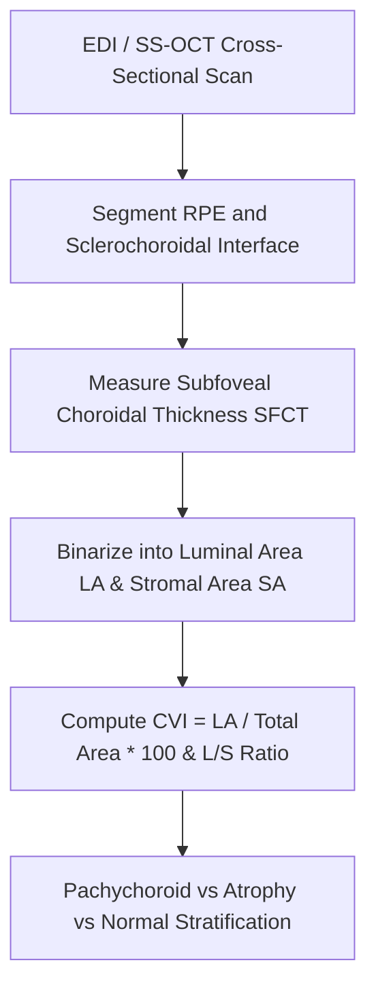

# Ocular Choroidal Vascularity Index (CVI) & Subfoveal Choroidal Thickness Skill

[](LICENSE)
[](https://www.python.org/)
[](https://modelcontextprotocol.io/)
[](requirements.txt)
[](https://github.com/alphaparkinc)

A zero-dependency, mathematically rigorous personal agent skill that evaluates choroidal vascular luminal proportions and subfoveal thickness via binarized Enhanced Depth Imaging Optical Coherence Tomography (EDI-OCT).

## Architecture



## Quick Start

```python
from client import ChoroidalVascularityIndexClient

client = ChoroidalVascularityIndexClient()
result = client.evaluate_cvi(
    subfoveal_choroidal_thickness_um=280.0,
    total_choroidal_area_mm2=1.25,
    luminal_area_mm2=0.82,
    patient_age_years=40
)
print("CVI (%):", result["choroidal_metrics"]["choroidal_vascularity_index_cvi_pct"])
print("Diagnosis:", result["clinical_diagnosis"]["choroidal_state"])
```

## License
Apache-2.0
